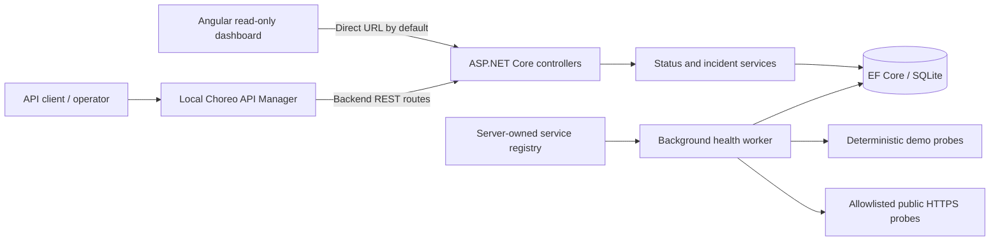
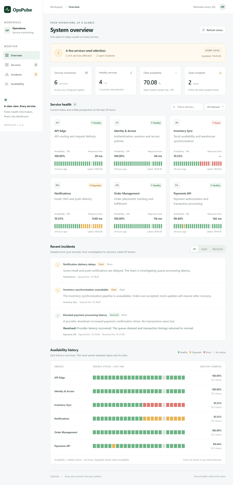
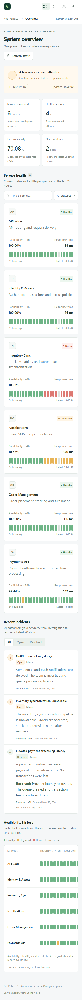

# OpsPulse

**Service health monitoring and incident management with a local Choreo API Manager integration.**

OpsPulse combines an ASP.NET Core .NET 10 REST API, an Angular standalone dashboard, and EF Core SQLite persistence. It demonstrates how an operations application can expose public status information while keeping incident operations behind separate access controls.

**This is a local engineering demonstration.** The default six services use deterministic simulated probes and seeded history. The dashboard labels this as **DEMO DATA**. The repository does not contain an API Manager installation, OAuth credentials, real service secrets, or production infrastructure.

The locally running gateway was checked at `https://localhost:8243/opspulse/1.0.0`: anonymous status/services reads succeeded, and anonymous incident listing was rejected with HTTP 401. Successful OAuth requests, incident writes through that gateway, and gateway rate limiting have **not** been verified. See [verification](docs/verification.md) for the exact evidence and limits.

## Problem and use case

When several APIs support an application, a team needs a shared view of service availability and a record of incidents. A customer-facing status page should reveal useful health information without disclosing probe destinations, operator credentials, or private operational configuration.

OpsPulse models this separation: configuration-owned probes collect observations, a public dashboard presents status and history, and an incident API records investigation and recovery. A local API gateway demonstrates where anonymous access and protected operations can be managed independently.

## Architecture



The backend validates its own incident write key. Gateway OAuth is a separate boundary; the backend does not implement JWT bearer authentication. The frontend currently uses the direct backend URL and contains no authentication secrets. More detail: [architecture](docs/architecture.md).

## Technology stack

| Area | Implementation |
| --- | --- |
| Backend | ASP.NET Core .NET 10, controllers, dependency injection, hosted worker |
| Persistence | Entity Framework Core 10, SQLite, checked-in schema migration |
| Frontend | Angular 21 standalone components, signals, RxJS, typed HttpClient |
| API contract | Generated OpenAPI 3.0 document; JSON Problem Details errors |
| Tests | xUnit, ASP.NET HTTP/SQLite integration tests, Vitest, Playwright |
| Container | Multi-stage .NET Dockerfile, unprivileged runtime user |
| Automation | GitHub Actions build/test/container workflow; no deployment job |
| API management | Locally observed gateway routes; manual integration instructions |

## Implemented features

- Register predefined services from validated server configuration and persist their public metadata.
- Display Healthy, Degraded, and Down status, response time, freshness, and 24-hour sample history.
- Poll demo probes or explicitly configured safe HTTPS endpoints, with bounded concurrency and timeouts.
- Block arbitrary request-supplied destinations, redirects, proxies, and private/special-use network addresses.
- Store health observations and prune expired samples using configurable retention.
- Create, list, view, and resolve incidents; repeated resolution preserves the first resolution.
- Return a public summary without probe URLs, keys, connection strings, or response bodies.
- Show a responsive read-only dashboard with search, filters, manual/automatic refresh, and connection failures.
- Seed six fictional services, 24 hours of synthetic samples, two open incidents, and one resolved incident.
- Validate requests and return consistent HTTP error responses with correlation IDs.

Incident lifecycle behavior is verified by isolated HTTP/SQLite integration tests. The synthetic records and displayed percentages are demonstration data, not measurements of real production services.

## Prerequisites

- .NET 10 SDK (10.0.102 or newer 10.0 feature band; see `global.json`). Use a current patched .NET 10 SDK/runtime for regular use.
- Node.js 24.x (24.0 or newer) and npm. Angular 21 also supports Node 20.19+ and 22.12+; see the [official compatibility table](https://angular.dev/reference/versions).
- Optional: Docker Desktop using Linux containers.

All commands below run in **Windows PowerShell**, starting at the repository root. Dependency installation is local to the project; no global Angular CLI or EF tool installation is needed.

## Run locally

Terminal 1:

```powershell
dotnet restore .\OpsPulse.slnx
dotnet run --project .\backend\OpsPulse.Api
```

The API listens at `http://localhost:5080`. On first startup it applies checked-in migrations, creates the ignored `backend/OpsPulse.Api/storage/opspulse.db`, registers configured services, and seeds demo records. Restarting does not duplicate the seed. Health polling runs immediately and every 30 seconds.

Terminal 2:

```powershell
Set-Location .\frontend
npm ci
npm start
```

Open **http://localhost:4200**. The dashboard refreshes every 30 seconds, with manual refresh, service search/status filtering, recent incident filtering, and hourly history. It shows connection failures and stale health checks explicitly. It contains no write controls or operator keys. All browser dates use the browser's local timezone; API timestamps are UTC.

## Backend endpoints and access

| Method | Route | Direct backend access |
| --- | --- | --- |
| GET | `/health` | Anonymous API/database readiness |
| GET | `/api/status` | Anonymous summary, history, latest 20 incidents and total open count |
| GET | `/api/services` | Anonymous enabled service registry and 24-hour history |
| GET | `/api/incidents?limit=50` | Anonymous public incident records; limit 1-100 |
| GET | `/api/incidents/{id}` | Anonymous individual public incident |
| POST | `/api/incidents` | Requires server-managed `X-OpsPulse-Key` |
| PATCH | `/api/incidents/{id}/resolve` | Requires server-managed `X-OpsPulse-Key` |
| GET | `/openapi/v1.json` | Anonymous generated OpenAPI 3.0 contract |

```powershell
Invoke-RestMethod http://localhost:5080/health
Invoke-RestMethod http://localhost:5080/api/status
.\scripts\smoke-test.ps1
.\scripts\export-openapi.ps1
```

The exported `docs/openapi.json` is suitable for review/import into an API manager. The runtime document is authoritative; re-export after API changes. Validation, authentication failures, missing resources, unsupported methods and unhandled errors use `application/problem+json` with a `traceId`. Detailed server exceptions are not returned to callers.

## Incident requests and backend authentication

Incident text is **public**. Do not include tokens, internal URLs, customer data or private operational details. Service health comes from probes; opening or resolving an incident does not override probe status.

Writes are disabled with HTTP 503 until `IncidentApi__WriteKey` is configured. Missing or invalid supplied keys return 401. To enable writes locally, enter an operator key of at least 32 characters from your password manager in the API terminal **before starting the API**:

```powershell
$secureKey = Read-Host 'Backend incident write key (32+ characters)' -AsSecureString
$env:IncidentApi__WriteKey = [System.Net.NetworkCredential]::new('', $secureKey).Password
dotnet run --project .\backend\OpsPulse.Api
```

In a separate PowerShell terminal, enter that same key without putting it in source code or shell history:

```powershell
$secureKey = Read-Host 'Incident write key' -AsSecureString
$credential = New-Object System.Net.NetworkCredential('', $secureKey)
$headers = @{ 'X-OpsPulse-Key' = $credential.Password }
$incident = Invoke-RestMethod -Method Post -Uri http://localhost:5080/api/incidents `
  -Headers $headers -ContentType 'application/json' -Body (@{
    serviceId = 'payments'
    title = 'Payment provider latency'
    description = 'Payment confirmations are delayed. The team is investigating.'
    severity = 'Major'
  } | ConvertTo-Json)

Invoke-RestMethod -Method Patch -Uri "http://localhost:5080/api/incidents/$($incident.id)/resolve" `
  -Headers $headers -ContentType 'application/json' -Body (@{
    resolution = 'The provider recovered and queued transactions completed.'
  } | ConvertTo-Json)
```

Allowed severities: `Minor`, `Major`, `Critical`. Titles: 3–120 characters; descriptions/resolutions: 10–1000. Invalid and unknown fields are rejected. Resolving twice returns the original resolution and timestamp, including under concurrent writes. The sample write key in tests is for in-memory test hosts only.

The exact DTOs are `OpsPulse.Api.Contracts.CreateIncidentRequest` and `ResolveIncidentRequest` in [ApiContracts.cs](backend/OpsPulse.Api/Contracts/ApiContracts.cs). The checked-in [incident.json](incident.json) contains a safe fictional creation request. A resolution body is:

```json
{ "resolution": "Gateway testing completed and the test incident is resolved." }
```

## Local Choreo API Manager integration

The gateway is a separately installed local dependency. Its binaries, downloaded archives, certificates, users, OAuth applications and private configuration are intentionally excluded from this repository.

1. Start the backend on `http://localhost:5080` and check `/health`.
2. Run `.\scripts\export-openapi.ps1` to refresh [docs/openapi.json](docs/openapi.json).
3. In the local API Manager Publisher, import that OpenAPI file. Use the [official import guide](https://apim.docs.wso2.com/en/latest/api-design-manage/design/create-api/create-rest-api/create-a-rest-api-from-an-openapi-definition/) for the installed version.
4. Configure the API context `/opspulse`, version `1.0.0`, and a backend endpoint reachable from the gateway. For a gateway running directly on the same Windows host, the endpoint is `http://localhost:5080`.
5. Configure resource policies deliberately: public status/services GETs can remain anonymous; incident resources can require OAuth and appropriate operator scopes. Keep readiness and OpenAPI resources internal if needed.
6. For POST/PATCH, configure the gateway to inject the backend `X-OpsPulse-Key` **after** authorizing an operator. Store that key in server/gateway secret storage. A bearer token does not replace the backend key.
7. Complete the API Manager lifecycle/revision/deployment steps required by that installation, then test the routes below. These are manual instructions, not automated gateway provisioning.

Observed local checks on 2026-11-19:

| Gateway route | Anonymous response | What this proves |
| --- | --- | --- |
| `GET /opspulse/1.0.0/api/status` | 200, expected six-service demo JSON | Local public status route works |
| `GET /opspulse/1.0.0/api/services` | 200 | Public service route is reachable |
| `GET /opspulse/1.0.0/api/incidents` | 401 | Anonymous incident access is denied |

The 401 check does not prove successful OAuth token validation, scopes, POST/PATCH authorization, or throttling. No live gateway incident mutation or rate-limit test was performed. See [integration notes](docs/choreo-integration.md).

## Gateway URL and curl.exe testing

The frontend's runtime public API URL is in [frontend/public/config.json](frontend/public/config.json):

```json
{ "apiBaseUrl": "http://localhost:5080" }
```

To route dashboard reads through the gateway later, set it to `https://localhost:8243/opspulse/1.0.0` and allow the exact frontend origin in the gateway's CORS configuration. Its public `/api/status` response contains the incident summary used by the dashboard, even when the standalone incident-list route is protected. The Angular client does not automatically attach OAuth tokens. Keep all keys, client secrets and bearer tokens out of this file and the frontend bundle.

From the repository root in PowerShell:

```powershell
$base = 'https://localhost:8243/opspulse/1.0.0'
curl.exe -k -i "$base/api/status"
curl.exe -k -i "$base/api/services"
curl.exe -k -i "$base/api/incidents"  # Anonymous access was observed as HTTP 401.
```

The following are manual protected-route examples. Obtain `$token` using your local API Manager's approved flow and keep it in the current shell's memory. No real token or OAuth client credential is included here. Do not enable curl verbose/trace logging with real credentials. `-k` bypasses TLS verification only for this local development certificate; use trusted TLS for shared environments.

```powershell
# Uses an existing $token; does not print or save it.
curl.exe -k -i "$base/api/incidents" -H "Authorization: Bearer $token"

# Requires OAuth authorization AND gateway injection of X-OpsPulse-Key.
$createdResponse = curl.exe -k --silent --show-error --fail-with-body `
  -X POST "$base/api/incidents" `
  -H "Authorization: Bearer $token" `
  -H 'Content-Type: application/json' `
  --data-binary '@incident.json'
if ($LASTEXITCODE -ne 0) { throw 'Incident creation failed; inspect $createdResponse.' }
$incidentId = (($createdResponse -join "`n") | ConvertFrom-Json).id
if (-not $incidentId) { throw 'No incident ID was returned.' }

$resolveJson = '{ "resolution": "Gateway testing completed and the test incident is resolved." }'
$resolveJson | curl.exe -k --silent --show-error --fail-with-body `
  -X PATCH "$base/api/incidents/$incidentId/resolve" `
  -H "Authorization: Bearer $token" `
  -H 'Content-Type: application/json' `
  --data-binary '@-'
if ($LASTEXITCODE -ne 0) { throw 'Incident resolution failed.' }
```

If the gateway is not injecting the backend key, an authorized operator must additionally supply `-H "X-OpsPulse-Key: $opsPulseKey"`, with the separately configured key held in memory. Successful POST/PATCH responses are expected to be 201 and 200 respectively; these gateway commands are instructions, not a claim that they succeeded.

## Configuration and safe service registration

Services are **registered by server configuration**, persisted at startup, and listed through GET. There is deliberately no destination-registration API. Edit `Monitoring:Services` in `backend/OpsPulse.Api/appsettings.json`, or supply server environment configuration. Removed service definitions are disabled on restart; their incidents/history remain stored. Restart to apply configuration changes.

- `Monitoring:Services`: unique lowercase IDs, public name/description, `Kind` (`Demo` or `Http`), and server-only probe settings.
- `Monitoring:AllowedHosts`: exact DNS host allowlist for HTTP probes. No wildcard hosts.
- `Monitoring:IntervalSeconds`: 15–3600; `TimeoutSeconds`: 1–15; `DegradedAfterMs`: positive and below timeout.
- `Monitoring:RetentionDays`: 1–90 (default 7). Polling prunes expired check records; incidents are retained.
- `Monitoring:SeedDemoData`: only seeds newly registered **Demo** services. Set false for real probes.
- `Cors:FrontendOrigin`: one exact origin, default `http://localhost:4200`, without a trailing slash. Only browser GET requests are allowed. CORS is not authentication.
- `ConnectionStrings:OpsPulse`: SQLite connection string; relative paths resolve against API content root.
- `IncidentApi:WriteKey`: server-only operator key, 32–1024 characters. Never set it in Angular or commit it.

`.env.example` documents environment names. ASP.NET Core **does not automatically load `.env`**; set PowerShell environment variables or pass an explicit Docker env file. Server configuration overrides use `__` for nesting.

For HTTP probes, replace the service list in server configuration, set `SeedDemoData` false, and explicitly allow the chosen DNS hosts. Use the full example in [docs/operations.md](docs/operations.md). HTTP destinations must use HTTPS port 443 with no embedded credentials, query string or fragment. Loopback/private/link-local/reserved IPs are blocked after DNS resolution. Redirects, proxies, cookies and response body downloads are disabled. Certificates are validated normally. The initial implementation intentionally does not monitor internal/private-network endpoints or authenticated endpoints.

Probe classification: 2xx is Healthy unless latency reaches the configured threshold (Degraded); 429 is Degraded; other responses, redirects, network errors and timeouts are Down. Stale healthy services appear Degraded after three polling intervals; the last stored sample remains visible. No checks means unavailable availability (`null`), never invented 100% uptime.

Availability is a **sample ratio**: Healthy ÷ all sampled checks in the trailing 24 hours. Degraded counts against availability. Hourly cells show the worst status sampled in that hour, or no checks. Fleet availability is the unweighted mean across services with samples. This is a demonstration metric, not a time-weighted SLA; synthetic seed sampling is every 15 minutes and ongoing polling every 30 seconds.

## Testing and verification

```powershell
dotnet build .\OpsPulse.slnx -c Release
dotnet test .\backend\OpsPulse.Tests -c Release --collect:'XPlat Code Coverage'
Set-Location .\frontend
npm ci
npm run build
npm test
```

Or run `./scripts/verify.ps1` from the root (add `-SkipFrontend` for backend only). xUnit integration tests use the real HTTP pipeline, migrations and in-memory **SQLite**, rather than the EF InMemory provider. Tests cover incident lifecycle/auth/validation, public field exposure, CORS, OpenAPI, persisted polling and retention, endpoint allowlisting and address safety. Angular tests cover configured API access, dashboard filters and error handling.

Optional browser checks, with the API running separately:

```powershell
Set-Location .\frontend
npx playwright install chromium
npm run test:e2e
```

This downloads a project tool's browser into the user cache; it does not install system-wide software. To use an already installed Edge browser on Windows, set `$env:OPSPULSE_BROWSER_CHANNEL = 'msedge'` before `npm run test:e2e`.

Verification for repository preparation on **2026-11-19**:

| Check | Observed result |
| --- | --- |
| .NET Release solution build | Passed, zero warnings/errors |
| xUnit unit and HTTP/SQLite integration tests | 65 passed; includes create, resolve, repeated resolution, auth and validation |
| Angular production build | Passed; initial bundle 196.96 kB |
| Angular/Vitest unit tests | 11 passed |
| Playwright with installed Edge | 2 passed; real local API, filters, mobile layout and connection failures |
| Local gateway reads | Status/services 200; anonymous incidents 401 |
| Live gateway OAuth success / incident mutations / rate limiting | Not verified |
| Production deployment | Not performed |

[GitHub Actions](.github/workflows/ci.yml) defines three build/test/container jobs. It contains no deployment or image-push step. Workflow configuration is distinct from a successful hosted run; use the repository's Actions tab for actual run results. Full commands, previous failures and verification limits are recorded in [docs/verification.md](docs/verification.md).

Before publishing source, run `node .\scripts\review-publication.mjs`. After staging, use `node .\scripts\review-publication.mjs --staged`. This best-effort scan reads candidate files, checks configured secret patterns and forbidden artifacts, and reports no matched secret values. It supplements manual review.

## Docker

From the root, with Docker Desktop running in Linux-container mode:

```powershell
docker build -t opspulse-api:local -f .\backend\OpsPulse.Api\Dockerfile .
docker volume create opspulse-data
docker run --rm --name opspulse-api -p 127.0.0.1:5080:8080 `
  --mount source=opspulse-data,target=/app/data opspulse-api:local
```

Stop the directly running API first to free port 5080. The multi-stage image runs as the unprivileged `app` user and stores SQLite in `/app/data`. The named volume persists across container restarts. Write endpoints remain disabled until a key is supplied through runtime environment configuration. Never bake credentials into the image. The frontend continues to use `http://localhost:5080`. Readiness: `Invoke-RestMethod http://localhost:5080/health`.

## Migrations

```powershell
dotnet tool restore
Push-Location .\backend\OpsPulse.Api
New-Item -ItemType Directory -Force storage | Out-Null
dotnet ef migrations add YourChange --output-dir Data/Migrations
dotnet ef database update
Pop-Location
```

The local EF tool is pinned in `dotnet-tools.json`. These design-time commands target the default local `storage/opspulse.db` in the API directory. Runtime environment overrides are used by the API's startup migrator. Schema migrations run at startup for this single-instance application. SQLite and startup migrations are intended for a single writer deployment; coordinate migrations and move to an appropriate shared database before scaling horizontally. Back up the SQLite database before schema changes. Do not commit database or generated runtime files.

## Screenshots

These are real Playwright captures of the local read-only dashboard displaying **simulated demo data**. They do not show authenticated API Manager operations or production monitoring.



<details>
<summary>Mobile dashboard capture</summary>



</details>

## Security considerations and limitations

- Public incident descriptions and resolutions are visible in the public summary. Use only information suitable for public disclosure; protecting the list route does not make the summary's incident text private.
- Incident writes require a server-only key; gateway OAuth is separately configured. There is no backend JWT bearer handler, per-user RBAC, MFA, or audit-log subsystem.
- Probe destinations are configuration-owned and restricted to explicitly allowed public HTTPS hosts. Internal-network and authenticated health endpoints are outside this implementation's scope.
- Demo probes are deterministic. Live external HTTPS probe behavior, production availability, and time-weighted SLAs are not claimed.
- Availability is a sample ratio, and degraded checks reduce it. SQLite/startup migrations target one application instance; horizontal scaling needs a different coordination/database design.
- The dashboard is read-only and has no token flow. CORS permits the configured development origin for GET requests; CORS is not authentication.
- `.gitignore` excludes `.env`, private overrides, databases, logs, credentials, certificates, archives, build output, downloaded API Manager runtime directories and local development artifacts. Safe redacted examples and source migrations are included.
- No secrets belong in screenshots, commits, shell transcripts or frontend configuration. If a real secret is committed, revoke/rotate it and clean the affected history before publication.
- No rate-limit policy or production deployment is implemented or claimed. Tests do not replace a production security assessment.

Future work: verified OAuth success/scopes and gateway incident workflows, reviewed gateway policy exports, rate-limit tests, alert delivery, operator identity/RBAC, structured observability, time-weighted metrics, and a coordinated migration/database strategy for multiple instances.

## Repository layout

```text
backend/OpsPulse.Api/     Controllers → services → EF Core SQLite
                         Background worker → configured probes → history
backend/OpsPulse.Tests/   xUnit unit and HTTP integration tests
frontend/                Angular standalone, public read-only API client
docs/                    Architecture, operations and gateway integration notes
scripts/                 PowerShell verification, smoke and OpenAPI export
.github/workflows/       Build/test/container CI; no deployment
```

Additional documentation: [architecture](docs/architecture.md), [operations](docs/operations.md), [gateway integration](docs/choreo-integration.md), and [verified results](docs/verification.md).

## Author

**Dimesh Methsara Opanayaka** - [Dimeshmethsara](https://github.com/Dimeshmethsara)

Prepared as a local engineering demonstration for a Choreo Labs internship application. Evidence and limitations are included so reviewers can distinguish implemented behavior, verified checks, and future work.
