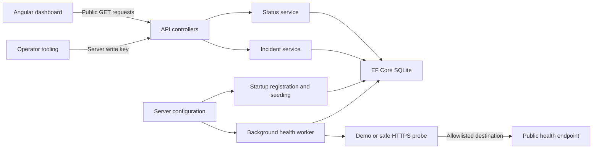

# Architecture

OpsPulse is a single-instance .NET 10 API and an independent Angular 21 application. All application endpoints use controllers, constructor injection and typed public response contracts.

## Boundaries

- **Controllers** handle routing, request validation, HTTP responses and authorization. They never accept health-check URLs.
- **Services** implement incident transitions and public status projections. DTOs explicitly include only public fields; no database entities or server configuration are returned.
- **Monitoring** reads validated, server-owned service definitions. Demo probes return deterministic values. HTTPS probes use a timeout, header-only response reads and a connection callback that resolves DNS, validates every returned IP, then connects directly to one validated address. TLS still verifies the configured DNS hostname.
- **Data** owns entities, indexes, UTC conversion, migration and initial registration/seeding. Endpoints and keys are not stored in the database. Health samples and incident records refer to the stable service slug.
- **Angular** uses standalone components, signals and a small read-only typed HTTP client. Runtime `config.json` supplies an API base URL including an optional gateway context path. Polling requests cannot overlap; failures preserve the last successful response with a visible warning.

## Persistence and history

Services hold the latest probe result, last sample timestamp and latency. Check records preserve individual observations with indexes on service/time and time alone. Each API service response includes 24 hourly buckets and a trailing 24-hour sample availability percentage. An hourly bucket uses the worst sampled status; an empty bucket is `null`. The first partial hour may be omitted from the displayed 24 calendar-hour buckets; the percentage and sample count always use the full rolling 24 hours.

Incidents track severity, open/resolved state, public description, creation/resolution timestamps and the resolution. Conditional database updates make resolution idempotent without allowing concurrent callers to replace the first operator's resolution. Incidents do not change observed service status.

Startup synchronizes configured registrations, disables removed services without deleting their historical records, and seeds only newly added demo services when enabled. A restart does not repair or overwrite real incident history. All timestamps are persisted and serialized as UTC. Poll cycles prune health samples older than the configured retention window; incidents are not automatically deleted.

## Security decisions

Public routes are intentionally anonymous. Mutation routes require `X-OpsPulse-Key`, validated with a constant-time hash comparison. Missing server configuration disables mutation with 503; missing/invalid client credentials return 401. The browser never receives this key. CORS permits GET only from one exact configured frontend origin; it does not protect server-to-server writes.

HTTP probe destinations have a second exact-host allowlist in addition to their immutable configured URLs. Private, loopback, link-local, metadata, multicast, reserved and documentation IP ranges are denied. IPv4-mapped IPv6 addresses are normalized. Special IPv6 translation/tunneling ranges are conservatively excluded. DNS is checked at connection time to prevent a validation/connect race. Proxies, redirects and cookies are disabled; response bodies are not downloaded. Requests use HTTPS on port 443 only. Health endpoints requiring credentials, query parameters or private network access are outside this version's supported probe scope.

Problem Details responses contain a trace ID and request path, with no stack traces or private configuration. SQLite files, local overrides, `.env` files and build artifacts are ignored by Git. The container runs as an unprivileged user. API reads use `Cache-Control: no-store` to prevent stale intermediary caches.

## Operational scope

SQLite supports this demo and a small single-instance service. It is not a coordinated multi-region monitoring system. Scheduling is per-process, incidents are operator-created, latency is measured until response headers arrive, and availability is sample-based. A crash between probe completion and persistence may lose that sample. There is no user identity system, alert delivery, audit-log system, distributed leader election or automatic incident correlation in this version.

Before a production gateway phase, add operator identity/RBAC, authenticated transport, rate limits, observability, explicit service ownership, durable alert delivery and a database/migration model suitable for the planned instance count. No production deployment is included.
